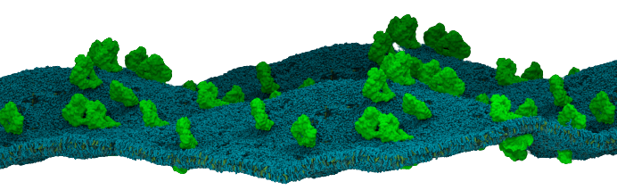

.. membrane_curvature documentation master file, created by
   sphinx-quickstart on Thu Mar 15 13:55:56 2018.
   You can adapt this file completely to your liking, but it should at least
   contain the root `toctree` directive.

MembraneCurvature's Documentation
=========================================================

**Minimum MDAnalysis version:** |MDAnalysis_version|

**Last updated:** |today|

The MDAnalysis **MembraneCurvature** tool calculates mean and Gaussian
curvature from Molecular Dynamics (MD) simulations.

**MembraneCurvature** derives 2D curvature maps from a surface of reference.
It offers flexible atom selection to use the most convenient ``AtomGroup``
to extract curvature from your MD simulations.

Features
----------

MembraneCurvature allows you to:

- Derive 2D surface profiles from MD simulations using an atom selection as reference with three
  different methods via the ``surface_method`` parameter: ``'fourier'`` (default),
  ``'binning_nearest'``, or ``'binning'``.
- Calculate mean and Gaussian curvature from the derived surface.
- Choose where curvature is evaluated with the ``curvature_on`` parameter:
  ``'per_frame'``, to get per-frame curvature maps, or
  ``'average_surface'``, to get curvature from the time-averaged surface.
- Control the surface calculation for the binning methods with two optional parameters:
   - ``padding``: periodic edge padding to reduce finite difference artifacts.
   - ``fft_filter``: a brick-wall FFT filter to remove high-frequency noise from the averaged surface.

Why MembraneCurvature?
-------------------------
**MembraneCurvature** is a user-friendly, actively maintained, well-documented tool
to derive 2D curvature maps from MD simulations, using the most recent version of `MDAnalysis`_.
Are you interested in mean and Gaussian curvature of your membranes? This tool is for you!

Installation
--------------

MembraneCurvature is available via pip, conda, and uv. Please refer to the
:ref:`install_membrane_curvature` section in :doc:`getting_started` for detailed
installation instructions.

Quick example
-------------

.. code-block:: python

      import MDAnalysis as mda
      from membrane_curvature.base import MembraneCurvature
      from MDAnalysis.tests.datafiles import XTC_MEMPROT, GRO_MEMPROT

      universe = mda.Universe(GRO_MEMPROT, XTC_MEMPROT)

      mc = MembraneCurvature(universe,
                             select='resid 297-517 and name P'
                             ).run()

      mean_curvature = mc.results.average_mean
      gaussian_curvature = mc.results.average_gaussian

.. note::

   This example uses test trajectory files from `MDAnalysisTests`_. See
   :ref:`install_membrane_curvature` for installation instructions.

You can find more details on how to use MembraneCurvature in the :ref:`usage`
page and in :doc:`getting_started`.

Citing MembraneCurvature
------------------------

If you use MembraneCurvature in your work, please cite the `MembraneCurvature paper`_:

   E. Barreto-Ojeda, V. Corradi, and D. P. Tieleman. MembraneCurvature: A Python
   tool to calculate membrane curvature from molecular dynamics simulations.
   *bioRxiv* (2026). doi: `10.64898/2026.11.25.769279`_

.. code-block:: bibtex

   @article{barretoojeda2026membranecurvature,
     title   = {MembraneCurvature: A Python tool to calculate membrane curvature from molecular dynamics simulations},
     author  = {Barreto-Ojeda, Estefania and Corradi, Valentina and Tieleman, D. Peter},
     journal = {bioRxiv},
     year    = {2026},
     doi     = {10.64898/2026.11.25.769279}
   }

.. note::

   MembraneCurvature includes a ``CITATION.cff`` file. On GitHub, use
   **Cite this repository** in the `MembraneCurvature repository`_ to export
   the citation in APA or BibTeX format.

License
-----------

Source code included in this project is available under the `GNU Public
License v3`_ from the `MembraneCurvature repository`_.

.. Contents
.. ========

.. toctree::
   :maxdepth: 3
   :caption: Contents:

   getting_started
   api
   ./source/pages/Algorithm
   ./source/pages/Usage
   ./source/pages/Visualization
   ./source/pages/Tutorials

.. _`GNU Public License v3`: https://www.gnu.org/licenses/gpl-3.0.en.html
.. _MDAnalysis: https://www.mdanalysis.org
.. _`MembraneCurvature repository`: https://github.com/MDAnalysis/membrane-curvature
.. _`MDAnalysisTests`: https://github.com/MDAnalysis/mdanalysis/wiki/UnitTests
.. _`MembraneCurvature paper`: https://doi.org/10.64898/2026.11.25.769279
.. _`10.64898/2026.11.25.769279`: https://doi.org/10.64898/2026.11.25.769279
.. |MDAnalysis_version| replace:: 2.4.0

Indices and tables
==================

* :ref:`genindex`
* :ref:`modindex`
* :ref:`search`

